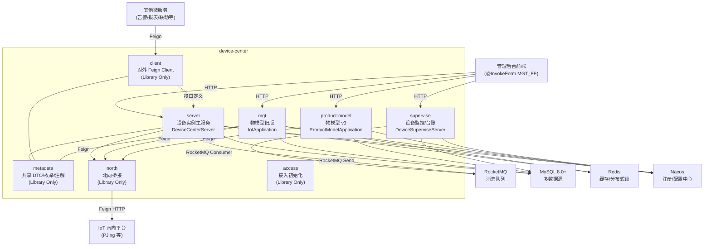

# device-center 模块架构文档

> **适用人群**：需要在此模块中开发、调试或 code review 的 agent / 开发人员。  
> **最后更新**：2026-03-04

---

## 一、模块定位

`device-center` 是 Cube2 IoT 平台的**设备中心**，处于 `packages/base` 基础业务层。它承担以下核心职责：

- **设备实例管理**：设备档案的 CRUD、分组、标签、空间坐标
- **物模型（Product Model）管理**：产品定义、属性/事件/方法建模、版本快照、导入导出
- **设备台账与监控（Supervise）**：设备退役/报废、健康值追踪、生命周期事件
- **北向接口桥接（North）**：与底层 IoT 平台（南向）的通信桥梁，封装设备属性、命令、事件的读写
- **对外服务接口（Client）**：通过 Feign Client 向其他微服务提供标准化设备查询能力

---

## 二、子模块全览

```
device-center/
├── server/          # 【主服务】设备实例管理，Spring Boot 入口
├── mgt/             # 【物模型管理】产品/属性/事件/方法的旧版本实现（含 openspec）
├── product-model/   # 【物模型 v3】产品/属性/事件/方法的新版重构
├── supervise/       # 【设备监控】台账、健康值、生命周期事件（独立微服务）
├── north/           # 【北向桥接】IoT 南向平台 Feign Client 封装
├── client/          # 【对外 Client】device-center 向其他服务暴露的 Feign 接口
├── metadata/        # 【共享元数据】DTO、枚举、注解、事件定义（无独立服务）
└── access/          # 【接入初始化】设备接入的初始化逻辑
```

---

## 三、各子模块详解

### 3.1 `server` — 设备中心主服务

| 维度 | 说明 |
|------|------|
| 入口类 | `DeviceCenterServer.java` |
| Spring Boot | `@SpringBootApplication`, 扫描 `com.guhecloud` |
| 包路径 | `com.guhecloud.cube.base.device.center` |
| 启动事件 | 启动后发布 `SysReadEvent`（系统就绪通知） |

**核心 Controller 清单**（路径前缀均含 `DEVICE_CENTER_MGT_FRONTEND_SUFFIX`）：

| Controller | 业务功能 |
|-----------|----------|
| `CenterDeviceInstanceController` | 设备分页、详情、更新、删除、密钥管理 |
| `CenterDeviceGroupController` | 设备分组 CRUD、批量删除、分组内设备管理 |
| `CenterDeviceBatchController` | 批量设备操作（批量导入/导出 Excel） |
| `CenterDeviceTagController` | 设备标签管理 |
| `CenterDeviceTagRuleController` | 标签规则管理 |
| `CenterDeviceCustomerTagController` | 自定义标签 |
| `CenterDeviceRefController` | 设备关联关系管理 |
| `CenterDeviceAttrCmdLogController` | 属性指令操作日志 |

**关键 API 示例**（`@InvokeForm(fromInvoke = From.SELF_MGT_FE)` 标记来源为管理后台前端）：

```
GET  {PREFIX}/device-instance/page             # 设备分页列表
GET  {PREFIX}/device-instance/detail-mgt/{id}  # 管理端设备详情
PUT  {PREFIX}/device-instance/device            # 更新设备信息
POST {PREFIX}/device-instance/device/delete    # 删除设备
PUT  {PREFIX}/device-instance/device/spatial-coordinates  # 更新空间坐标
POST /device-instance/pwd-check                # 设备密码校验
POST /application-devices/page                 # 子应用设备分页（待迁移）
```

**核心数据模型**（`src/core/model/`）：

```
BizDevice         → 设备实例主表（核心档案）
BizDeviceExpand   → 设备扩展信息表（到期时间、状态等）
BizDeviceRef      → 设备关联关系表
BizGroup          → 设备分组表
BizTag / BizTagRule → 标签与标签规则
```

---

### 3.2 `mgt` — 物模型管理（旧版）

> 注意：`mgt` 目前有 OpenSpec 驱动，是**物模型**功能的主要落地模块（`product-model` 是重构产物）。

**目录结构**：

```
mgt/
├── openspec/        # OpenSpec 规范文件（project.md + specs + changes）
├── src/             # 主源码
│   ├── v2/          # 业务层（Controller → Service → Mapper）
│   └── server/      # Spring Boot 入口（IotApplication.java）
├── resources/       # 数据库 Liquibase 迁移脚本、MyBatis XML
└── tests/           # 测试代码
```

**业务领域**（来自 `openspec/project.md`）：

```
产品（Product）
 ├── 节点类型
 │    ├── 1 - 直连设备
 │    ├── 2 - 网关设备
 │    └── 3 - 网关子设备
 ├── 属性（Property）  ← prop_code 唯一，支持 int/float/string/boolean/enum 等
 ├── 事件（Event）     ← event_code 唯一，如告警、状态变化
 └── 方法（Method）   ← method_code 唯一，同步/异步远程指令
```

**关键 Controller**（`src/base/controller/`，`src/acc/controller/`）：

| Controller | 端点特征 | 功能 |
|-----------|---------|------|
| `CommonDictController` | `/dict/*` | 通用字典管理 |
| `ProdBrandController` | `/prod/brand/*` | 产品品牌管理 |
| `ProdCategoryController` | `/prod/category/*` | 产品品类管理 |
| `ProtocolController` | `/protocol/*` | 通信协议管理 |

**核心服务**（`src/base/service/`）：

- `SysDictService` / `SysDictItemService` — 系统字典（含内存缓存 `SysDictCacheInMemoryService`）
- `CommandInfoService` / `CommandRecordService` — 指令信息与执行记录
- `ProdBrandService` + `ProdCategoryService` — 产品品牌/品类业务逻辑

---

### 3.3 `product-model` — 物模型 v3（重构版）

> 这是 `mgt` 的新版重构，使用 `v3` 包结构，路径前缀 `/v3/things/*`。

**入口类**：`ProductModelApplication.java`（独立 Spring Boot 服务）

**Controller 完整清单**（`src/v3/controller/`）：

| Controller | 路径前缀 | 功能 |
|-----------|---------|------|
| `V3ProductController` | `/v3/things/product` | 产品 CRUD、分页 |
| `V3ProductPropController` | `/v3/things/product/prop` | 属性管理 |
| `V3ProductEventController` | `/v3/things/product/event` | 事件管理 |
| `V3ProductMethodController` | `/v3/things/product/method` | 方法/指令管理 |
| `V3ProductModelVersionController` | `/v3/things/product/version` | 物模型版本快照 |
| `V3ProductModelImportExportController` | `/v3/things/product/io` | JSON 导入导出 |
| `V3ProductBrandController` | `/v3/things/brand` | 产品品牌 |
| `V3ProductCategoryController` | `/v3/things/category` | 产品品类 |
| `V3ProtocolController` | `/v3/things/protocol` | 通信协议 |
| `V3DictItemController` | `/v3/things/dict` | 字典项 |

**删除守卫机制**（`src/v3/guard/`）：

- `DeletionGuardManager` 管理统一删除前置校验
- 各实体各自实现 `DeletionGuard`：`ProductDeletionGuard`、`PropertyDeletionGuard`、`EventDeletionGuard`、`MethodDeletionGuard`

**版本快照 DTO 结构**：

```
ProductModelSnapshotDTO
 ├── ProductSnapshotDTO          # 产品信息（屏蔽DB ID，使用 prod_number）
 ├── List<PropertySnapshotDTO>   # 所有属性快照
 ├── List<EventSnapshotDTO>      # 所有事件快照（含 EventConfig/EventRule）
 └── List<MethodSnapshotDTO>     # 所有方法快照
```

---

### 3.4 `supervise` — 设备监控与台账服务

| 维度 | 说明 |
|------|------|
| 入口类 | `DeviceSuperviseServer.java` |
| 包路径 | `com.guhecloud.cube.srv.gen.device.supervise` |
| 独立微服务 | 是，与 `server` 部署独立 |

**功能域分层**：

```
supervise/
├── server/
│   └── src/account/            # 设备台账域
│       ├── interfaces/          # Controller 层
│       ├── commandgateway/      # 写命令网关（Command Service）
│       ├── querygateway/        # 读查询网关（Query Service）
│       ├── event/rocketmq/      # RocketMQ 消费者（监听设备生命周期事件）
│       ├── po/                  # 数据库实体
│       └── dao/                 # MyBatis Mapper
└── client/
    └── src/                     # 供其他服务调用的 Feign Client
```

**台账核心 Controller API**（`DeviceAccountController`）：

```
GET  /device-account/deviceIds           # 获取所有台账设备 ID
POST /device-account/{id}/decommissioning # 设备退役
POST /device-account/{id}/scrapping       # 设备报废
POST /device-account/batch               # 批量入账
POST /device-account/{id}/collect        # 收藏设备
POST /device-account/{id}/collect/cancel # 取消收藏
DELETE /device-account/{id}              # 删除台账记录
```

**生命周期事件**（RocketMQ 消费者）：

- `DeviceLifeEventMessageConsumer` — 消费设备生命周期事件消息（上线/下线等）
- `DeviceLifeEventDelMessageConsumer` — 消费设备生命周期事件删除消息

**健康值 Client**（`HealthValueClient`，Feign）：

```
GET  /device/instance/analysis/health/value/scene-type  # 按场景类型获取健康值
POST /device/instance/analysis/health/value/last/batch  # 批量获取设备健康值
GET  /device/instance/analysis/health/avg-value         # 按标签获取平均健康值
```

**核心数据表**：

- `DeviceAccountPO` — 设备台账主表
- `DeviceAccountCollectPO` — 用户收藏设备
- `DeviceLifeEventsPO` — 生命周期事件记录
- `DeviceBusinessUrlPO` — 设备业务 URL 配置

---

### 3.5 `north` — 北向接口桥接层

> 封装与底层 IoT 平台（如 PJing）的通信，避免上层业务直接耦合 IoT 平台 API。

**子模块**：

```
north/
├── client/    # Feign Client 集合，调用 IoT 南向平台
└── consumer/  # RocketMQ 消费者（订阅 IoT 平台消息）
```

**Client 接口清单**（包前缀 `com.guhecloud.cube.iot.north.bridge.client`）：

| Client | 功能 |
|--------|------|
| `IotDeviceClient` | 设备分页、详情、添加、属性名查询 |
| `IotDevicePropClient` | 设备属性读写、历史時序数据查询 |
| `IotDeviceEventClient` | 设备事件历史查询 |
| `IotDeviceEventExtClient` | 设备事件扩展查询 |
| `IotCommandClient` | 指令下发、状态查询 |
| `IotProductClient` | 产品（物模型）信息同步 |
| `IotProductMethodClient` | 产品方法调用 |
| `IotSubscribeClient` | 订阅管理 |
| `IotLinkageClient` | 设备联动规则 |

**关键路径模式**（`/north/*`）：

```
GET  /north/device/page        # 设备分页
GET  /north/device/detail      # 设备详情
POST /north/device/add         # 添加设备到 IoT 平台
GET  /north/device/devicePropName  # 设备属性名映射
```

---

### 3.6 `client` — 对外 Feign Client

> **device-center 对其他微服务暴露的 Feign 接口层**，外部服务通过引入此模块依赖来调用设备中心。

**主入口**：`DeviceCenterClient.java`（`@Deprecated`，已标记废弃，迁移至 `std/devcenter/*`）

**新版标准 Client 集合**（`src/std/devcenter/`）：

| Client | 功能 |
|--------|------|
| `DeviceCenterStdClient` | 标准设备查询（列表、分页、详情） |
| `DeviceCenterAssociatedStdClient` | 设备关联关系查询 |
| `DeviceCenterAttrCtlStdClient` | 属性控制操作 |
| `DeviceCenterAttrCmdLogClient` | 属性指令日志查询 |
| `DeviceCenterTagStdClient` | 设备标签查询 |
| `DeviceGroupStdClient` | 设备分组查询 |
| `DeviceBimSceneStdClient` | BIM 场景相关设备查询 |
| `ProductCategoryClient` | 产品品类查询 |
| `ProductClient` | 产品信息查询 |
| `DeviceBaseStatisticsClient` | 设备统计（在线/离线/区域分布） |

**已废弃 API（`DeviceCenterClient`，下个版本移除）**：

```
POST /device/instance-self-info/list   # 设备自身信息批量查询（→标签替代）
POST /device/online/count              # 在线设备数统计
POST /area-point                       # 经纬度分组（→标签替代）
POST /device/status/count              # 设备状态分组统计（→标签替代）
```

---

### 3.7 `metadata` — 共享元数据层

> **无独立服务**，仅提供跨模块共用的类型定义，作为库被 `server`、`client` 等引用。

**主要内容**（`src/`）：

| 包 | 内容 |
|----|------|
| `src/dto/` | 跨模块 DTO（`DeviceBaseDetailsDTO`、`DeviceProductInfoDTO`、`CenterBizDeviceDTO` 等 117+ 个） |
| `src/lang/` | 枚举定义（`DeviceInstanceStatusEnum`、`DataTypeEnum`、`TagTypeEnum`、`SortEnum` 等） |
| `src/param/` | 标准查询参数（`DeviceBaseInfoPageQry`、`QueryDeviceByAreaAndTagParam` 等） |
| `src/event/` | 领域事件定义（`DeviceChange`、`DeviceGroupChange`、`DeviceInfo`、`CommandExecuteCallbackEvent`） |
| `src/annotation/` | 自定义注解（`@InvokeForm`、`@VersionInfo`） |
| `src/std/dto/` | 标准规范 DTO |
| `src/std/vo/` | 标准规范 VO（`DeviceInfoVO`、`DeviceGroupVO` 等） |
| `src/std/param/` | 标准规范参数（`CreateGroupCommand`、`CreateTagBizGroupCommand`） |

**关键枚举说明**：

```java
DeviceInstanceStatusEnum  // 设备在线状态（在线/离线/故障等）
DataTypeEnum              // 数据类型（int/long/float/string/boolean/date/enum...）
TagTypeEnum               // 标签类型
From                      // 调用来源（SELF_MGT_FE = 管理后台前端 等）
AttributePermissionEnum   // 属性读写权限
AttrCtlExecuteResultEnum  // 属性控制执行结果
```

**特殊注解**：

- `@InvokeForm(fromInvoke = From.XXX)` — 标注 API 调用来源（管理后台/第三方等）
- `@VersionInfo(plannedRemove = "...")` — 标注计划废弃的 API

---

### 3.8 `access` — 接入初始化

> 超轻量模块，负责设备接入时的初始化逻辑（如系统字典初始化）。

```
access/
├── BUILD.bazel
└── init/          # 初始化逻辑（InitSystemCategoryDic、InitSystemDic 等）
```

---

## 四、整体架构图



---

## 五、数据流说明

### 5.1 设备注册流程

```
前端 → POST {prefix}/device-instance/device
     → CenterDeviceInstanceController
     → CenterDeviceService
     → BizDeviceMapper (写入 MySQL)
     → [可选] NORTH/IotDeviceClient (同步到 IoT 平台)
     → RocketMQ 发布 DeviceChange 事件
```

### 5.2 设备属性控制流程

```
前端/业务服务 → DeviceCenterAttrCtlStdClient (Feign)
           → server: 属性指令 Controller
           → north: IotCommandClient (发送到 IoT 平台)
           → RocketMQ: CommandExecuteCallbackEvent (异步回调)
           → server: 写入 CommandLog/CommandRecord
```

### 5.3 物模型变更流程（v3）

```
前端 → POST /v3/things/product
     → V3ProductController
     → V3MdProductService
     → DeletionGuardManager (前置校验)
     → V3MdProductMapper (写 MySQL)
     → 发布 ProductCreatedEvent / ProductUpdatedEvent
     → 物模型版本快照生成 (ProductModelSnapshotDTO → JSON 存储)
```

### 5.4 设备生命周期监控流程

```
IoT 平台 → RocketMQ 发布设备上线/下线消息
         → supervise: DeviceLifeEventMessageConsumer
         → DeviceLifeEventsCommandService
         → DeviceLifeEventsPO → MySQL (写入 supervise DB)
```

---

## 六、技术栈

| 技术 | 版本/说明 |
|------|----------|
| Java | 17+ |
| Spring Boot | 3.x |
| Spring Cloud | Feign + Nacos |
| MyBatis Plus | 3.x，ORM 框架 |
| MySQL | 8.0+，utf8mb4 |
| Redis | 缓存 + 分布式锁 |
| RocketMQ | 异步消息 + 事件驱动 |
| Nacos | 服务注册 + 配置管理 |
| Liquibase | 数据库版本管理 |
| Bazel | 构建工具（非 Maven/Gradle） |
| Lombok | 减少样板代码 |
| Jackson / Fastjson2 | JSON 处理 |
| EasyExcel | Excel 导入导出 |

---

## 七、代码规范与约束

### 7.1 分层规范

```
Controller → Service → (Mapper | 其他Service | Feign)
                 ↑
        跨模块调用通过 Feign Client，禁止直接依赖其他模块 Mapper
```

### 7.2 命名约定

| 类型 | 规范 | 示例 |
|------|------|------|
| 实体/PO | `{Entity}` 或 `{Entity}PO` | `BizDevice`, `DeviceAccountPO` |
| DTO | `{Entity}DTO` | `DeviceBaseDetailsDTO` |
| VO | `{Entity}VO` | `DeviceDetailVO` |
| 参数 | `{Entity}{Action}Param` | `DevicePageParam` |
| 命令 | `{Entity}{Action}Command` 或 `Cmd` | `ChangeDeviceInfoCmd` |
| Service 接口 | `{Entity}Service` | `CenterDeviceService` |
| Service 实现 | `{Entity}ServiceImpl` | `CenterDeviceServiceImpl` |
| Mapper | `{Entity}Mapper` | `CenterBizDeviceMapper` |

### 7.3 业务约束

- **多租户**：所有表含 `tenant` 字段，查询必须带租户过滤
- **逻辑删除**：通过 `deleted` 字段标记，**禁止物理删除**
- **版本快照**：物模型修改必须生成 JSON 快照
- **分页强制**：列表查询必须分页
- **事务范围**：事务在 Service 层，使用 `@Transactional(rollbackFor = Exception.class)`
- **注释语言**：所有代码注释、文档必须使用**中文**

### 7.4 废弃 API 标记

使用 `@VersionInfo(plannedRemove = "说明")` 标注计划移除的 API，使用 `@Deprecated` 标注已废弃类。

---

## 八、OpenSpec 变更管理

`mgt` 子模块引入了 **OpenSpec** 规范驱动开发流程：

```
openspec/
├── project.md       # 项目约束与领域知识（必读）
├── specs/           # 已实现的能力规范
└── changes/         # 进行中的变更提案
```

**触发使用条件**：新功能、破坏性变更、架构调整、性能/安全重构时，必须先创建 `proposal.md` 并通过评审，再开始实现。

```bash
# 查看当前变更
openspec list
# 查看已有规范
openspec list --specs
# 校验变更
openspec validate <change-id> --strict
```

---

## 九、模块依赖关系

```
server      → metadata, north/client
client      → metadata
mgt         → metadata, north/client, north/consumer
product-model → mgt（间接）
supervise   → (独立)
north/client → (IoT平台 HTTP 接口)

外部依赖：
  - platform/base        (工具类/标准接口)
  - platform/database    (MyBatis Plus 增强)
  - platform/security    (JWT 认证)
  - platform/rocketmq    (消息队列)
  - platform/event       (事件驱动框架)
  - packages/base/ouaa/client  (用户认证授权)
  - packages/base/file/client  (文件管理)
```

---

## 十、快速定位指南

| 需求场景 | 找哪里 |
|---------|--------|
| 设备档案 CRUD | `server/src/core/controller/CenterDeviceInstanceController.java` |
| 设备分组管理 | `server/src/core/controller/CenterDeviceGroupController.java` |
| 物模型（产品/属性/事件/方法）v3 | `product-model/src/v3/controller/V3Product*Controller.java` |
| 物模型版本快照 | `product-model/src/v3/controller/V3ProductModelVersionController.java` |
| 物模型 JSON 导入导出 | `product-model/src/v3/controller/V3ProductModelImportExportController.java` |
| 设备台账/退役/报废 | `supervise/server/src/account/interfaces/DeviceAccountController.java` |
| 设备健康值 | `supervise/client/src/HealthValueClient.java` |
| 生命周期事件消费 | `supervise/server/src/account/event/rocketmq/consumer/` |
| 向 IoT 平台下发指令 | `north/client/src/IotCommandClient.java` |
| 读取设备属性时序数据 | `north/client/src/IotDevicePropClient.java` |
| 对外 Feign 接口（供其他服务调用） | `client/src/std/devcenter/` |
| 共享 DTO / 枚举 | `metadata/src/dto/` + `metadata/src/lang/` |
| 领域约束 + 技术背景 | `mgt/openspec/project.md` |
